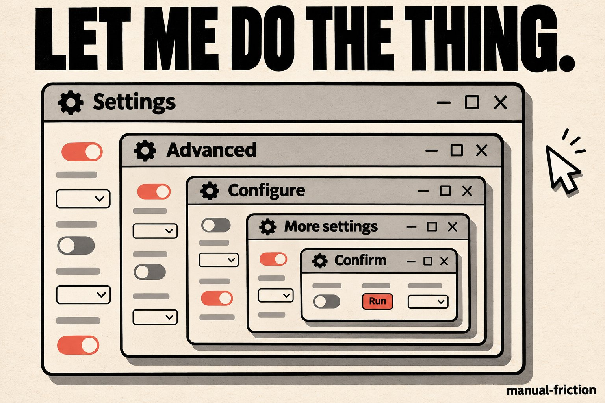

# Manual Friction Antipattern

An agent skill that keeps manual friction out of the products AI agents build, and measures what gets through.

Manual friction is work a person does that the product already had enough information to do itself: a signed-in account set up again for each project, a restart before something new works, a detour to Settings from the screen that needed it, a generic error, a greyed-out button with no reason, a picker with one option, a confirmation on something that could be undone. Generated interfaces collect it by default, because the dashboards, settings pages and wizards in their training data were built for software that only did what it was told.

The skill works in five parts:

1. **Journey first.** Write the person's path and the steps only they can supply (intent, a real choice, an approval, a secret, a physical action) before any screen is built.
2. **Defaults and disclosure.** Every decision the product can infer becomes a default; settings show intent-level controls only; missing setup opens inside the flow.
3. **Banned patterns.** Fourteen screen and code patterns the agent refuses, from restart-to-apply to buttons that exist only because of how the app stores the work, with a ripgrep scan for diffs.
4. **Scoring review.** Weight each friction event by what it costs the person, from Time (1) to Way forward (10).
5. **Installed-app walk.** Score the journey in the running app. This decides whether a change passes: in the calibration run, 28 of 33 points only showed up there.

A main journey passes with a friction ratio of 1.5 or less, a score of 5 or less, and no events that lose the person's work or leave them stuck.

## Install

Claude Code:

```bash
git clone https://github.com/markrpg/manual-friction-antipattern ~/.claude/skills/manual-friction
```

It loads when you design, build or review UI, or when you type `/manual-friction`.

Any other agent: paste the prompt in [PROMPT.md](PROMPT.md).

## Score a journey

Record the walk in a scorecard ([template](templates/scorecard.json)) and run:

```bash
python3 scripts/friction_score.py examples/small-repo.json
```

Python 3, no dependencies. It prints the ratio, score, every event and which budget rules failed.

To block a release that adds friction, run it in your automated build checks: it exits with an error when the journey is over budget, which fails the check.

## Files

| File | Contents |
|---|---|
| [SKILL.md](SKILL.md) | What the agent follows |
| [references/measure.md](references/measure.md) | Definitions, reach of approvals, counting rules, weights, budgets |
| [references/patterns.md](references/patterns.md) | Build habits with replacements, banned patterns, static scan |
| [examples/small-repo.md](examples/small-repo.md) | The scored calibration run (33 points, broken band) |
| [templates/](templates) | Journey card and scorecard |

## License

MIT. See [LICENSE](LICENSE).
